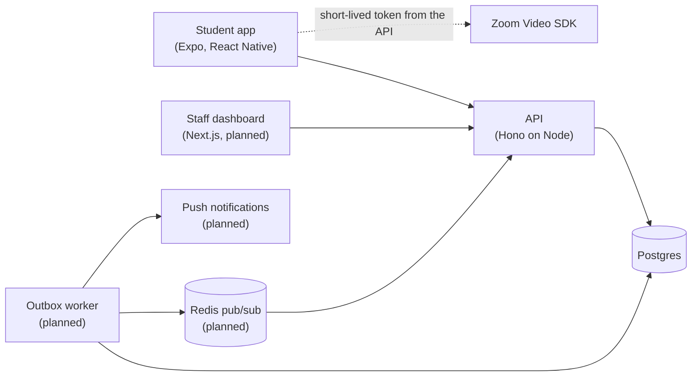

# OpenDoor

Fair office hours from your phone. Students join a queue from an app, get a push notification when it's their turn, and drop into a camera-off video call. Staff call the next student with one click, and the queue stays correct even when several staff click at the same moment.

Personal project. Not affiliated with Zoom.

## Why

Office hours are often a crowded line or a free-for-all chat. Students with jobs or caregiving can't sit and watch a screen, and the loudest person tends to go first. OpenDoor is built around a few commitments:

- **No visible line, no fighting for airtime.** Your phone pings you when it's your turn.
- **Fairness rules everyone can see**, like first-time visitors this week going first.
- **Camera off by default.** Visibility isn't the price of getting help.
- **No surveillance.** No attendance tracking, no per-student reports, no recordings. Queue entries are deleted 30 days after a session closes.

## The interesting problem: a fair, correct "Call next"

Two staff members clicking "Call next" at the same moment must call two different students, in fairness order, and a double-click must never call the same student twice. The design:

1. **Postgres as a work queue.** The next student is claimed with `SELECT ... FOR UPDATE SKIP LOCKED`, so concurrent clicks each claim a different row without waiting on each other's locks. No separate queue service is needed.
2. **Idempotency keys.** Each click carries a unique key. A retry or double-click with the same key returns the first result instead of calling another student.
3. **Transactional outbox.** Marking a student as called and recording the "student called" event happen in one transaction. A separate worker sends the notification afterward, so the queue never says "called" without the alert eventually going out, and a failed push never undoes who was called.
4. **Rules in the database.** A partial unique index allows only one active entry per student per session, so racing "Join" requests can't both win. A partial index on waiting rows keeps the claim query fast as history grows.

The proof will be an integration test against a real Postgres that fires 50 concurrent "Call next" requests and checks that exactly the first 50 students were called, none twice.

## Architecture



- **A modular monolith with event-driven edges:** one TypeScript codebase that runs as an API and a separate worker.
- **Video never touches the servers.** The API signs a short-lived Video SDK token, and the app connects to Zoom directly. No Zoom credentials live in the app.
- **Shared contracts.** Zod schemas in `packages/shared` define every request once, for the API, the web dashboard, and the mobile app.

## Stack

| Layer | Choice |
| --- | --- |
| Monorepo | pnpm workspaces, Turborepo |
| API | TypeScript, Hono on Node |
| Database | Postgres 17, Drizzle ORM and migrations |
| Mobile | Expo (development build), React Native, Zoom Video SDK |
| Web | Next.js (planned) |
| Infrastructure | AWS CDK: ECS Fargate on ARM (Graviton), ECR, CloudWatch Logs |
| CI | GitHub Actions: typecheck, test, build on every push |
| Tests | Vitest; Testcontainers for the concurrency test (planned); k6 for load (planned) |

## Engineering decisions

- **The API bundles into a single file.** `tsup` bundles the API and its libraries into `dist/index.js`, so the container needs only Node and one file. The image is built in two stages, runs as a non-root user, and a `.dockerignore` keeps secrets out.
- **Deployed cheaply on purpose.** One small ARM Fargate task in public subnets, with no NAT gateway and no load balancer, costs about $5 for two weeks. A load balancer comes in when there's a second task or a real domain with HTTPS.
- **Liveness and readiness are separate.** `/health` only checks that the process is up, and it's what ECS watches. `/ready` checks the database. A database blip shouldn't make the orchestrator restart every container at once.
- **Infrastructure as code.** The whole AWS setup is a TypeScript CDK stack in `infra/`, typechecked in CI like everything else.
- **React Native New Architecture.** Expo SDK 58 only runs the New Architecture, and the Zoom React Native SDK doesn't support it natively yet. A spike confirmed it builds and joins a session through React Native's compatibility layer, with a browser-call fallback if that ever breaks.

## Repository layout

```
apps/api         Hono API, Drizzle schema and migrations, Dockerfile
apps/mobile      Expo app (student side)
packages/shared  Zod schemas shared by every app
infra            AWS CDK stack (VPC, ECS Fargate, logs)
```

## Running locally

Requires Node 24, pnpm 10, and Docker.

```bash
pnpm install
docker compose up -d                          # local Postgres
cp apps/api/.env.example apps/api/.env        # then fill in the values
pnpm --filter @opendoor/api db:migrate
pnpm --filter @opendoor/api dev               # API on http://localhost:4000
curl http://localhost:4000/ready              # {"status":"ok"} when the database is reachable
```

The mobile app needs an Expo development build (Expo Go can't load the Zoom SDK). On an iPhone, with Xcode installed:

```bash
cd apps/mobile
npx expo run:ios --device
```

## License

MIT
